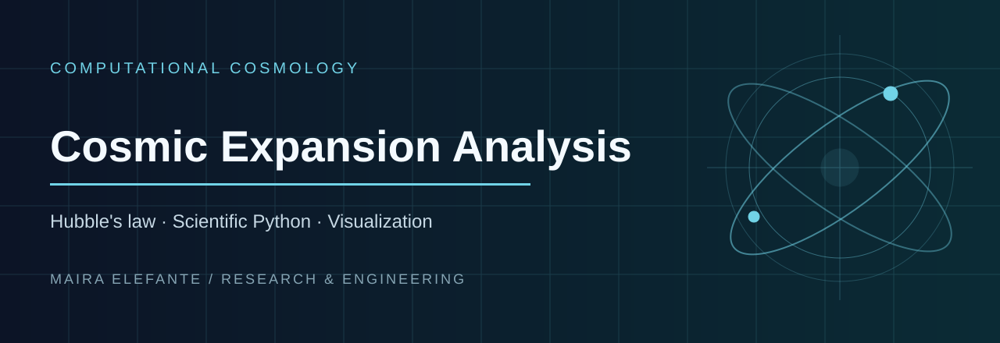

> **Hubble's law · Scientific Python · Visualization**

**Focus:** Computational Cosmology · [Source and project files](./)

---

# Cosmic Expansion Analysis

A small but structured project exploring the expansion of the universe through Hubble’s law, combining basic cosmology concepts with simple computational modeling.

## Overview

One of the most important discoveries in modern cosmology is that the universe is expanding. Galaxies are moving away from us with a velocity proportional to their distance.

This project explores this relation and highlights both its usefulness and its limitations.

## The Model

The starting point is Hubble’s law:

v = H₀ · d

where:
- v is the recession velocity
- H₀ is the Hubble constant
- d is the distance

## What this project does

- Implements Hubble’s law in Python
- Visualizes the velocity–distance relation
- Provides a simple interpretation of cosmic expansion
- Discusses the limits of the linear approximation

## Key Insight

While the relation appears simple, it is only valid at relatively small cosmological distances. At larger scales, a full relativistic treatment is required.

## Run the model

Install the numerical and plotting packages, then run the actual entry point:

```bash
python3 -m pip install numpy matplotlib
python3 redshift_project.py
```

The script plots Hubble's law for an illustrative value of H₀ = 70 km/s/Mpc.

## Files

- [`redshift_project.py`](redshift_project.py) → Python model and visualization
- `notes.md` → theoretical notes and interpretation

## Why this project

This project is part of my effort to build a clear and structured understanding of astroparticle physics and cosmology, combining theory with simple computational tools.

## Author

Maira Elefante  
Physics student (MSc Astroparticle Physics) 
